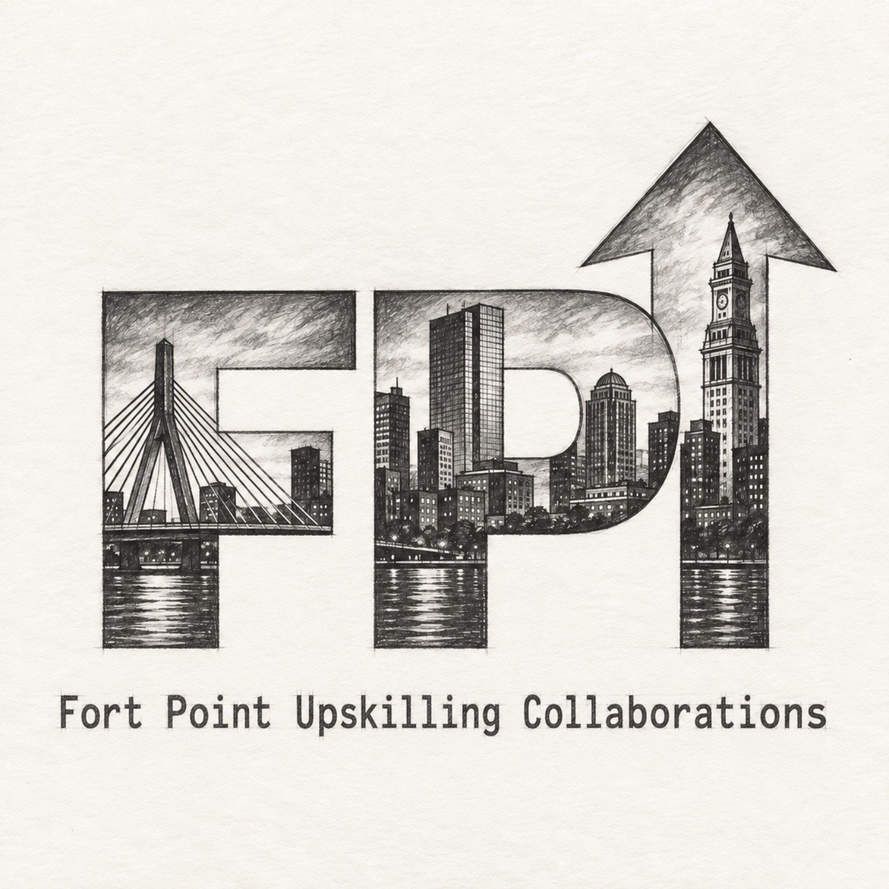

# Fort Point Upskilling Collaborations: Project Hub

Public catalogs, collaboration summaries, participation information, and community documentation.

## Explore

- [Short project catalog](catalogs/FP-up_SHORT_Catalog_2026%20-09-28.md)
- [Long project catalog](catalogs/FP-up_LONG_Catalog_2026-09-28.md)
- [Current collaborations](COLLABORATIONS.md)
- [Participating community members](COMMUNITY.md)
- [How to contribute](CONTRIBUTING.md)
- [Code of conduct](CODE_OF_CONDUCT.md)

Working repositories may be private during early collaboration. This public hub records shareable descriptions, opt-in participant recognition, and results that collaborators approve for release.

## Propose or join a collaboration

Read [CONTRIBUTING.md](CONTRIBUTING.md), then contact an organization owner or open an issue in this repository. A useful proposal can be small: a reproducible experiment, a dataset check, a documentation improvement, a test, or a clearly framed research question.

## Public credit and privacy

Listing on the public community page is optional. Contributors control whether their preferred name, GitHub username, interests, and collaboration links appear. Anyone listed may request an edit or removal.

